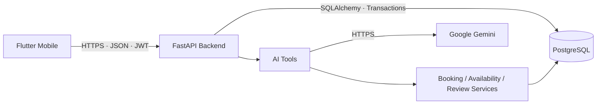

<div align="center">

# SlotBridge

**Қызмет көрсететін бизнеске арналған жазылу жүйесі: екі рет жазуға жол бермейді, жоспар өзгергенде уақытты жоғалтпайды және клиентке бүкіл сапарға бір сөйлеммен жазылуға мүмкіндік береді.**

[English](README.md) · [Русский](README.ru.md) · Қазақша

[](https://slotbridge-api.onrender.com)
[](https://github.com/artyom129/SlotBridge/releases/tag/v1.1.6)
[](https://github.com/artyom129/SlotBridge/actions/workflows/tests.yml)
[](LICENSE.md)

**[APK жүктеу](https://github.com/artyom129/SlotBridge/releases/download/v1.1.6/SlotBridge-1.1.6-10-production.apk)** ·
**[v1.1.6 релизі](https://github.com/artyom129/SlotBridge/releases/tag/v1.1.6)** ·
**[Production API](https://slotbridge-api.onrender.com)** ·
**[Архитектура](docs/architecture.md)** ·
**[Орнату](docs/setup.md)**

</div>

## SlotBridge не үшін керек

Салон, клиника немесе студия күнтізбемен өмір сүреді. Сағат 14:00-де бір орындықта екі клиент, ешкім алмаған бос уақыт, шаш қидырып, маникюр жасатқысы келіп, екі рет қоңырау шалатын клиент: мұның бәрі әр апта сайын ақша шығарады.

SlotBridge осы жағдайлар айналасында құрылған толық жазылу платформасы. Клиент қызмет пен шеберді таңдайды, нақты бос уақытты көреді, жазылады, сапарды ауыстырады не болдырмайды, кейін пікір қалдырады. Барлық ережені бэкенд ұстайды. Екі адам бір уақытты ала алмайды, бір ұйым екіншісінің деректерін ешқашан көрмейді, бәрі PostgreSQL-да сақталады.

Жүйе қазір өндірісте жұмыс істейді: **Flutter → FastAPI → PostgreSQL**, API Render-де, база Supabase-те, Android қосымшасы GitHub Releases арқылы шығады.

## Клиент не істей алады

| Бөлім | Не кіреді |
| --- | --- |
| Жазылу | Қызметті, шеберді және нақты бос уақытты таңдау |
| Сапарлар | Жазылу, ауыстыру, болдырмау, тізім және тарих |
| Кесте | Smart Slots, күту тізімі, Conflict Rescue |
| Бір сапарда бірнеше қызмет | Үш бағыт стратегиясы бар Smart Journey |
| AI көмекші | Қарапайым сөзбен жазылу, ауыстыру, болдырмау және уақыт іздеу |
| Пікірлер | Сапардан кейінгі пікір, шебер рейтингі, модерация, шағым, ресми жауап |
| Пікір талдауы | Талдау және клиентті жасыратын Gemini қорытындылары |
| Профиль | Тіркелу, кіру, өңдеу |
| Тілдер | Орыс және ағылшын |
| Безендіру | Ашық, қараңғы және жүйелік тақырып |
| Жаңарту | Қосымшада релизді тексеру, APK жүктеу, SHA-256 тексеру, Android орнатушысы |
| Сенімділік | Транзакциялар, идемпотенттілік, ұйымдарды оқшаулау, қос жазылу жоқ |

## SlotBridge AI

Клиент «жұма күні алтыдан кейін Аидаға шаш қию, содан кейін маникюр» деп жазады, қалғанын көмекші істейді. Ол қызметтер мен шеберлерді табады, күнді, апта күнін және уақытты түсінеді, нақты бостықты тексереді, бірнеше қызметпен бірге жұмыс істейді және қадамдар арасындағы әңгімені есте сақтайды.

Gemini тек бэкенд арқылы жұмыс істейді. Ол рұқсат етілген құралдар мен домен сервистерін шақырады және PostgreSQL-ды, JWT-ны, құпия сөздерді немесе кілттерді ешқашан көрмейді. Деректерді өзгертетін кез келген әрекет (жазылу, ауыстыру, болдырмау) клиенттің нақты растауын күтеді.

## Smart Journey

Smart Journey бірнеше қызметті бір сапарға жинайды. Бағыт қызметкерлердің нақты бостығына, қызмет ұзақтығына, күту уақытына және кім не істей алатынына қарап құрылады. Үш стратегия бар:

- **Ең жылдам**: бүкіл сапар ең қысқа
- **Ең ерте**: сәйкес келетін ең ерте басталу
- **Аз шебер**: мамандар арасында мүмкіндігінше аз ауысу

Бүкіл бағыт бір транзакциямен брондалады. Бір қадам бос емес аралықпен қиылысса, ештеңе жасалмайды, клиент жарты сапармен қалмайды.

## Сенуге болатын пікірлер

Пікірді тек `COMPLETED` мәртебесі бар нақты жазылуға және бір рет қана қалдыруға болады. Ұйым, қызмет, шебер және клиент сұраныс денесінен емес, сервердегі жазылудан алынады.

Пікірде 1-ден 5-ке дейін жалпы баға, сапа, қызмет көрсету және уақытылық бойынша жеке бағалар, қалауынша түсініктеме, жасырын режим және өңдеу мерзімі бар. Шеберлердің жиынтық рейтингі мен жұлдыздар бөлінісі бар. Модераторлар `PUBLISHED`, `HIDDEN` және `FLAGGED` мәртебелерімен жұмыс істейді, шағымдар қайталанудан қорғалған, қызметкер немесе ұйым ресми жауап бере алады.

Жоғары бағадан кейін клиентке ұйымның тексерілген 2GIS бетіне сілтеме ұсынуға болады. SlotBridge ішіндегі ештеңе 2GIS-ке автоматты түрде жарияланбайды.

## Архитектура



Толығырақ [`docs/architecture.md`](docs/architecture.md).

| Қабат | Стек |
| --- | --- |
| Мобильді қосымша | Flutter, Dart, Riverpod, GoRouter, Dio, Secure Storage |
| Бэкенд | Python 3.12, FastAPI, SQLAlchemy, Alembic |
| База | PostgreSQL |
| AI | Google Gemini API |
| Инфрақұрылым | Render, Supabase PostgreSQL, GitHub Releases |
| Тесттер | Pytest, Flutter Test, GitHub Actions |

## Қауіпсіздік және сенімділік

- JWT арқылы кіру, рөлдер және ұйымдарды қатаң оқшаулау
- Құпия сөздер Argon2 арқылы
- PostgreSQL транзакциялары және белсенді жазылу аралықтарына exclusion constraints, сондықтан қос жазылуды базаның өзі қабылдамайды
- Барлық маңызды өзгерістерде идемпотенттілік
- Кіріс вебхуктар үшін HMAC тексеру
- AI ұсынатын кез келген өзгеріс алдында нақты растау
- Құпиялар тек бэкендте: Git-те де, мобильді қосымшада да жоқ
- Өндірісте HTTPS

## Android жаңартулары

Қосымша дүкенсіз өзі жаңарады. Ол релиз деректерін оқиды, GitHub Releases-тен жаңа APK жүктейді, SHA-256 тексереді, бұрын тексерілген пакет болса соны пайдаланады және оны Android орнатушысына береді.

## Өндіріс

| Компонент | Күйі |
| --- | --- |
| Android | **v1.1.6 · versionCode 10** |
| Бэкенд | [Render](https://slotbridge-api.onrender.com) |
| База | Supabase PostgreSQL |
| Тасымалдау | HTTPS |
| APK | [GitHub Releases](https://github.com/artyom129/SlotBridge/releases/tag/v1.1.6) |
| Health | `GET /api/v1/health/live` |

API Render-дің тегін тарифінде жұмыс істейді, сондықтан ұзақ үзілістен кейінгі бірінші сұраныс сервер оянғанша сәл ұзағырақ жүреді.

## Репозиторий

| Қалта | Ішінде не бар |
| --- | --- |
| `app/` | FastAPI маршруттары, модельдер, схемалар және сервистер |
| `mobile/` | Flutter-дегі Android клиенті |
| `tests/` | Бэкендтің юнит, интеграциялық және параллель тесттері |
| `alembic/` | PostgreSQL миграциялары |
| `docs/` | Архитектура және орнату |
| `scripts/` | Іске қосу, деректер толтыру, тексерулер |
| `.github/workflows/` | CI |

## Өзіңізде іске қосу

Толық нұсқаулық: [`docs/setup.md`](docs/setup.md).

Бэкенд:

```powershell
python -m venv .venv
.\.venv\Scripts\Activate.ps1
python -m pip install -r requirements.txt
Copy-Item .env.example .env
alembic upgrade head
uvicorn app.main:app --host 0.0.0.0 --port 8000 --reload
```

Swagger: `http://127.0.0.1:8000/docs`

Windows-қа орнатылған PostgreSQL-мен: `.\start_slotbridge.bat`, тоқтату `.\stop_slotbridge.bat`. Docker арқылы: `docker compose up --build`.

Мобильді қосымша (телефон API-ды көруі үшін компьютердің жергілікті желідегі мекенжайын көрсетіңіз):

```powershell
cd mobile
flutter pub get
flutter run --dart-define=API_BASE_URL=http://<сіздің-lan-ip>:8000
```

Өндіріске құрастыру:

```powershell
flutter build apk --release --dart-define=API_BASE_URL=https://slotbridge-api.onrender.com
```

## Баптаулар

`.env.example` ішінде тек қауіпсіз толтырғыштар.

| Айнымалы | Не үшін |
| --- | --- |
| `SLOTBRIDGE_ENVIRONMENT` | `development`, `test` немесе `production` |
| `DATABASE_URL` | PostgreSQL мекенжайы |
| `JWT_SECRET` | JWT қолтаңба құпиясы |
| `CORS_ALLOWED_ORIGINS` | Рұқсат етілген көздер |
| `GEMINI_API_KEY` | Gemini кілті, тек бэкендте |
| `GEMINI_MODEL` | Бэкенд қолданатын Gemini моделі |
| `REVIEW_EDIT_WINDOW_HOURS` | Пікірді өңдеу мерзімі, әдепкі `24` |

Өндіріс құпиялары хостинг ортасында сақталады және репозиторийге ешқашан түспейді.

## Миграциялар

```powershell
alembic current
alembic upgrade head
```

Схеманы және PostgreSQL шектеулерін Alembic басқарады. Пікірлер `20260924_0006` миграциясымен келеді: пікірлер, шағымдар, жауаптар, аудит журналы және 2GIS баптаулары.

## Пікірлер API

| Эндпоинт | Не үшін |
| --- | --- |
| `POST /reviews` | Аяқталған жазылуға пікір |
| `GET/PATCH/DELETE /reviews/{id}` | Оқу, өзгерту немесе жұмсақ жою |
| `GET /me/reviews` | Ағымдағы клиенттің пікірлері |
| `GET /appointments/{id}/review` | Нақты жазылу бойынша пікір |
| `GET /employees/{id}/reviews` | Шебер туралы жарияланған пікірлер |
| `GET /employees/{id}/rating` | Рейтинг және жұлдыздар бөлінісі |
| `POST /reviews/{id}/reports` | Пікірге шағымдану |
| `PUT /reviews/{id}/reply` | Ресми жауап |
| `GET /admin/organizations/{id}/reviews` | Модерация кезегі |
| `PATCH /admin/organizations/{id}/review-settings` | Тексерілген 2GIS сілтемесі |
| `PATCH /admin/reviews/{id}/moderation` | Пікірді жасыру, белгілеу немесе қайтару |
| `PATCH /admin/review-reports/{id}` | Шағымды жабу немесе қабылдамау |
| `GET /admin/organizations/{id}/reviews/analytics` | Пікірлер талдауы |
| `GET /admin/organizations/{id}/reviews/ai-summary` | Gemini-дің жасырын қорытындысы |

## Тесттер

```powershell
python -m pytest
```

```powershell
cd mobile
flutter analyze
flutter test
```

CI бэкенд тесттерін нақты PostgreSQL-да іске қосады, оның ішінде он сұраныс бір уақыт үшін таласып, дәл бір жазылу шығатын параллель тест бар, ал қосымша үшін `flutter analyze` пен `flutter test` іске қосылады.

## Автор

[Koncha Artyom](https://github.com/artyom129) · Python бэкенд, автоматтандыру, өнім әзірлеу

## Лицензия

SlotBridge **қарап шығуға ашық кодты меншікті бағдарламалық жасақтама**. Код зерттеп, бағалау үшін ашық, бірақ бұл open source емес.

Пайдалану, өзгерту, тарату, сату, ребрендинг немесе басқа өнімге енгізу үшін рұқсат қажет, егер [`LICENSE.md`](LICENSE.md) немесе міндетті заң басқаша рұқсат етпесе.

Толық шарттар: [LICENSE](LICENSE.md) · [NOTICE](NOTICE)

**Copyright © 2026 Artyom Koncha. All Rights Reserved.**
