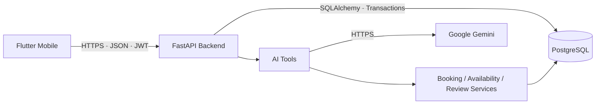

<div align="center">

# SlotBridge

**Booking for service businesses that does not double-book, does not lose a slot when plans change and lets a client book a whole visit in one sentence.**

English · [Русский](README.ru.md) · [Қазақша](README.kk.md)

[](https://slotbridge-api.onrender.com)
[](https://github.com/artyom129/SlotBridge/releases/tag/v1.1.6)
[](https://github.com/artyom129/SlotBridge/actions/workflows/tests.yml)
[](LICENSE.md)

[](https://flutter.dev/)
[](https://fastapi.tiangolo.com/)
[](https://www.postgresql.org/)
[](https://ai.google.dev/)
[](https://www.python.org/)

**[Download APK](https://github.com/artyom129/SlotBridge/releases/download/v1.1.6/SlotBridge-1.1.6-10-production.apk)** ·
**[Release v1.1.6](https://github.com/artyom129/SlotBridge/releases/tag/v1.1.6)** ·
**[Production API](https://slotbridge-api.onrender.com)** ·
**[Architecture](docs/architecture.md)** ·
**[Setup](docs/setup.md)**

</div>

## Why SlotBridge exists

A salon, a clinic or a studio lives and dies by its calendar. Two clients in one chair at 14:00, a cancelled slot nobody fills, a client who wants a haircut and a manicure and has to call twice: each of these costs money every week.

SlotBridge is a full booking platform built around those moments. The client picks a service and a specialist, sees real free time, books, moves or cancels the visit and leaves a review afterwards. The backend owns every rule. Two people cannot take the same slot, one organization never sees another's data, and everything lives in PostgreSQL.

It runs in production today: **Flutter → FastAPI → PostgreSQL**, with the API on Render, the database on Supabase and the Android app shipped through GitHub Releases.

## What a client can do

| Area | What it covers |
| --- | --- |
| Booking | Choose a service, a specialist and a real free slot |
| Appointments | Book, move, cancel, list and open past visits |
| Scheduling | Smart Slots, Waitlist, Conflict Rescue |
| Several services in one visit | Smart Journey with three route strategies |
| AI assistant | Book, move, cancel and check free time in plain words |
| Reviews | Reviews after a visit, specialist ratings, moderation, reports, official replies |
| Review insights | Analytics and Gemini summaries that keep clients anonymous |
| Profile | Sign-up, sign-in, profile editing |
| Languages | Russian and English |
| Appearance | Light, dark and system theme |
| Updates | Release check in the app, APK download, SHA-256 check, Android installer |
| Reliability | Transactions, idempotency, tenant isolation, no double booking |

## SlotBridge AI

A client writes "a haircut with Aida on Friday after six, then a manicure" and the assistant does the rest. It finds the services and specialists, understands dates, weekdays and times, checks real availability, handles several services at once and remembers the conversation between steps.

Gemini works only through the backend. It calls approved backend tools and domain services and never sees PostgreSQL, JWTs, passwords or secrets. Anything that changes data (a booking, a move, a cancellation) waits for the client's explicit confirmation.

## Smart Journey

Smart Journey turns several services into one visit. It builds the route from real employee availability, service length, waiting time and who can do what, with three strategies:

- **Fastest**: the shortest total visit
- **Earliest**: the earliest start that works
- **Fewer specialists**: as few handovers as possible

The whole journey is booked in one transaction. If any step collides with a taken interval, nothing is booked, so a client never ends up with half a visit.

## Reviews that mean something

A review can only be left for a real appointment with status `COMPLETED`, once. The organization, service, specialist and client are taken from the appointment on the server, never from the request body.

A review has an overall score from 1 to 5, separate scores for quality, service and punctuality, an optional comment, an anonymous public mode and an edit window. Specialists get rating aggregates and a star distribution. Moderators work with `PUBLISHED`, `HIDDEN` and `FLAGGED`, reports are protected from duplicates, and an employee or the organization can post an official reply.

After a high score the client may get a link to the organization's verified 2GIS page. Nothing from inside SlotBridge is posted to 2GIS automatically.

## Architecture



More in [`docs/architecture.md`](docs/architecture.md).

| Layer | Stack |
| --- | --- |
| Mobile | Flutter, Dart, Riverpod, GoRouter, Dio, Secure Storage |
| Backend | Python 3.12, FastAPI, SQLAlchemy, Alembic |
| Database | PostgreSQL |
| AI | Google Gemini API |
| Infrastructure | Render, Supabase PostgreSQL, GitHub Releases |
| Testing | Pytest, Flutter Test, GitHub Actions |

## Security and reliability

- JWT sign-in, roles and strict tenant isolation
- Argon2 password hashing
- PostgreSQL transactions and exclusion constraints on active booking intervals, so the database itself refuses a double booking
- Idempotency on every critical write
- HMAC checks on incoming webhooks
- Explicit confirmation before any change the AI proposes
- Secrets live only on the backend: none in Git, none in the mobile app
- HTTPS in production

## Android updates

The app updates itself without a store. It reads release metadata, downloads the newest APK from GitHub Releases, checks its SHA-256, reuses a package it has already verified and hands it to the Android installer.

## Production

| Component | Status |
| --- | --- |
| Android | **v1.1.6 · versionCode 10** |
| Backend | [Render](https://slotbridge-api.onrender.com) |
| Database | Supabase PostgreSQL |
| Transport | HTTPS |
| APK | [GitHub Releases](https://github.com/artyom129/SlotBridge/releases/tag/v1.1.6) |
| Health | `GET /api/v1/health/live` |

The API runs on Render's free tier, so the first request after a quiet period takes a little longer while the server wakes up.

## Repository

| Folder | What is inside |
| --- | --- |
| `app/` | FastAPI routes, models, schemas and backend services |
| `mobile/` | Flutter Android client |
| `tests/` | Backend unit, integration and concurrency tests |
| `alembic/` | PostgreSQL migrations |
| `docs/` | Architecture and setup |
| `scripts/` | Start, seed, checks and helpers |
| `.github/workflows/` | CI |

## Run it locally

Full guide: [`docs/setup.md`](docs/setup.md).

Backend:

```powershell
python -m venv .venv
.\.venv\Scripts\Activate.ps1
python -m pip install -r requirements.txt
Copy-Item .env.example .env
alembic upgrade head
uvicorn app.main:app --host 0.0.0.0 --port 8000 --reload
```

Swagger: `http://127.0.0.1:8000/docs`

With a native PostgreSQL on Windows: `.\start_slotbridge.bat`, stop with `.\stop_slotbridge.bat`. With Docker: `docker compose up --build`.

Mobile (use your computer's LAN address so the phone can reach the API):

```powershell
cd mobile
flutter pub get
flutter run --dart-define=API_BASE_URL=http://<your-lan-ip>:8000
```

Production build:

```powershell
flutter build apk --release --dart-define=API_BASE_URL=https://slotbridge-api.onrender.com
```

## Configuration

`.env.example` holds safe placeholders only.

| Variable | Purpose |
| --- | --- |
| `SLOTBRIDGE_ENVIRONMENT` | `development`, `test` or `production` |
| `DATABASE_URL` | PostgreSQL connection URL |
| `JWT_SECRET` | JWT signing secret |
| `CORS_ALLOWED_ORIGINS` | Allowed origins |
| `GEMINI_API_KEY` | Gemini key, backend only |
| `GEMINI_MODEL` | Gemini model the backend uses |
| `REVIEW_EDIT_WINDOW_HOURS` | Review edit window, `24` by default |

Production secrets belong in the hosting environment, never in the repository.

## Migrations

```powershell
alembic current
alembic upgrade head
```

Alembic owns the schema and the PostgreSQL constraints. Reviews arrive with migration `20260924_0006`: reviews, reports, replies, an audit log and the 2GIS settings.

## Review API

| Endpoint | Purpose |
| --- | --- |
| `POST /reviews` | Review a completed appointment |
| `GET/PATCH/DELETE /reviews/{id}` | Read, edit or soft-delete a review |
| `GET /me/reviews` | The current client's reviews |
| `GET /appointments/{id}/review` | The review for one appointment |
| `GET /employees/{id}/reviews` | Published reviews of a specialist |
| `GET /employees/{id}/rating` | Rating aggregates and star distribution |
| `POST /reviews/{id}/reports` | Report a review |
| `PUT /reviews/{id}/reply` | Post or update an official reply |
| `GET /admin/organizations/{id}/reviews` | Moderation queue |
| `PATCH /admin/organizations/{id}/review-settings` | Set the verified 2GIS link |
| `PATCH /admin/reviews/{id}/moderation` | Hide, flag or restore a review |
| `PATCH /admin/review-reports/{id}` | Resolve or dismiss a report |
| `GET /admin/organizations/{id}/reviews/analytics` | Review analytics |
| `GET /admin/organizations/{id}/reviews/ai-summary` | Anonymous Gemini summary |

## Tests

```powershell
python -m pytest
```

```powershell
cd mobile
flutter analyze
flutter test
```

CI runs the backend suite against a real PostgreSQL, including the concurrency test where ten requests race for one slot and exactly one booking comes out, and runs `flutter analyze` and `flutter test` for the app.

## Author

[Koncha Artyom](https://github.com/artyom129) · Python backend, automation, product development

## License

SlotBridge is **proprietary, source-available software**. The code is public so it can be reviewed and evaluated; that does not make it open source.

Using, changing, redistributing, selling, rebranding or building it into another product needs permission, unless [`LICENSE.md`](LICENSE.md) or mandatory law allows it.

Full terms: [LICENSE](LICENSE.md) · [NOTICE](NOTICE)

**Copyright © 2026 Artyom Koncha. All Rights Reserved.**
