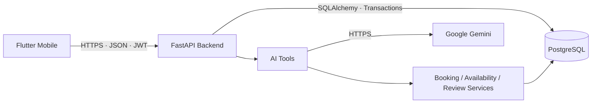

<div align="center">

# SlotBridge

**Запись для сервисного бизнеса, которая не допускает двойных записей, не теряет окно, когда планы меняются, и даёт клиенту записаться на весь визит одной фразой.**

[English](README.md) · Русский · [Қазақша](README.kk.md)

[](https://slotbridge-api.onrender.com)
[](https://github.com/artyom129/SlotBridge/releases/tag/v1.1.6)
[](https://github.com/artyom129/SlotBridge/actions/workflows/tests.yml)
[](LICENSE.md)

**[Скачать APK](https://github.com/artyom129/SlotBridge/releases/download/v1.1.6/SlotBridge-1.1.6-10-production.apk)** ·
**[Релиз v1.1.6](https://github.com/artyom129/SlotBridge/releases/tag/v1.1.6)** ·
**[Production API](https://slotbridge-api.onrender.com)** ·
**[Архитектура](docs/architecture.md)** ·
**[Установка](docs/setup.md)**

</div>

## Зачем нужен SlotBridge

Салон, клиника или студия живут календарём. Два клиента в одном кресле в 14:00, отменённое окно, которое никто не занял, клиент, который хочет стрижку и маникюр и звонит дважды: всё это каждую неделю стоит денег.

SlotBridge это полноценная платформа записи, построенная вокруг этих моментов. Клиент выбирает услугу и мастера, видит настоящее свободное время, записывается, переносит или отменяет визит, а потом оставляет отзыв. Все правила держит бэкенд. Два человека не могут занять одно окно, одна организация никогда не видит данные другой, всё хранится в PostgreSQL.

Система работает в продакшене: **Flutter → FastAPI → PostgreSQL**, API на Render, база в Supabase, Android-приложение выходит через GitHub Releases.

## Что может клиент

| Раздел | Что входит |
| --- | --- |
| Запись | Выбор услуги, мастера и реального свободного окна |
| Визиты | Запись, перенос, отмена, список и история |
| Расписание | Smart Slots, лист ожидания, Conflict Rescue |
| Несколько услуг за визит | Smart Journey с тремя стратегиями маршрута |
| AI-ассистент | Запись, перенос, отмена и поиск времени обычными словами |
| Отзывы | Отзывы после визита, рейтинг мастеров, модерация, жалобы, официальные ответы |
| Аналитика отзывов | Сводка и анонимные резюме от Gemini |
| Профиль | Регистрация, вход, редактирование |
| Языки | Русский и английский |
| Оформление | Светлая, тёмная и системная тема |
| Обновления | Проверка релиза в приложении, загрузка APK, проверка SHA-256, установщик Android |
| Надёжность | Транзакции, идемпотентность, изоляция организаций, никаких двойных записей |

## SlotBridge AI

Клиент пишет «стрижка у Аиды в пятницу после шести, потом маникюр», остальное делает ассистент. Он находит услуги и мастеров, понимает даты, дни недели и время, проверяет реальную занятость, работает с несколькими услугами сразу и помнит разговор между шагами.

Gemini работает только через бэкенд. Он вызывает разрешённые инструменты и доменные сервисы и никогда не видит PostgreSQL, JWT, пароли или секреты. Всё, что меняет данные (запись, перенос, отмена), ждёт явного подтверждения клиента.

## Smart Journey

Smart Journey собирает несколько услуг в один визит. Маршрут строится по реальной занятости сотрудников, длительности услуг, времени ожидания и тому, кто что умеет. Стратегий три:

- **Быстрее всего**: самый короткий визит целиком
- **Раньше всего**: самое раннее начало, которое подходит
- **Меньше мастеров**: как можно меньше передач между специалистами

Весь маршрут бронируется одной транзакцией. Если хоть один шаг пересекается с занятым интервалом, не создаётся ничего, и клиент не остаётся с половиной визита.

## Отзывы, которым можно верить

Отзыв можно оставить только на настоящую запись со статусом `COMPLETED`, и только один. Организация, услуга, мастер и клиент берутся из записи на сервере, а не из тела запроса.

В отзыве общая оценка от 1 до 5, отдельные оценки за качество, сервис и пунктуальность, комментарий по желанию, анонимный режим и окно для редактирования. У мастеров есть сводный рейтинг и распределение звёзд. Модераторы работают со статусами `PUBLISHED`, `HIDDEN` и `FLAGGED`, жалобы защищены от дублей, сотрудник или организация могут дать официальный ответ.

После высокой оценки клиенту можно предложить ссылку на проверенную страницу организации в 2GIS. Ничего из SlotBridge в 2GIS автоматически не публикуется.

## Архитектура



Подробнее в [`docs/architecture.md`](docs/architecture.md).

| Слой | Стек |
| --- | --- |
| Мобильное приложение | Flutter, Dart, Riverpod, GoRouter, Dio, Secure Storage |
| Бэкенд | Python 3.12, FastAPI, SQLAlchemy, Alembic |
| База | PostgreSQL |
| AI | Google Gemini API |
| Инфраструктура | Render, Supabase PostgreSQL, GitHub Releases |
| Тесты | Pytest, Flutter Test, GitHub Actions |

## Безопасность и надёжность

- Вход по JWT, роли и строгая изоляция организаций
- Пароли через Argon2
- Транзакции PostgreSQL и exclusion constraints на активные интервалы записей, так что двойную запись отклоняет сама база
- Идемпотентность на всех важных изменениях
- Проверка HMAC для входящих вебхуков
- Явное подтверждение перед любым изменением, которое предлагает AI
- Секреты только на бэкенде: ни в Git, ни в мобильном приложении
- HTTPS в продакшене

## Обновления на Android

Приложение обновляется само, без магазина. Оно читает данные релиза, скачивает свежий APK из GitHub Releases, проверяет SHA-256, использует уже проверенный пакет, если он есть, и передаёт его установщику Android.

## Продакшен

| Компонент | Статус |
| --- | --- |
| Android | **v1.1.6 · versionCode 10** |
| Бэкенд | [Render](https://slotbridge-api.onrender.com) |
| База | Supabase PostgreSQL |
| Транспорт | HTTPS |
| APK | [GitHub Releases](https://github.com/artyom129/SlotBridge/releases/tag/v1.1.6) |
| Health | `GET /api/v1/health/live` |

API работает на бесплатном тарифе Render, поэтому первый запрос после простоя идёт чуть дольше, пока сервер просыпается.

## Репозиторий

| Папка | Что внутри |
| --- | --- |
| `app/` | Маршруты FastAPI, модели, схемы и сервисы |
| `mobile/` | Android-клиент на Flutter |
| `tests/` | Юнит-, интеграционные и конкурентные тесты бэкенда |
| `alembic/` | Миграции PostgreSQL |
| `docs/` | Архитектура и установка |
| `scripts/` | Запуск, наполнение данными, проверки |
| `.github/workflows/` | CI |

## Запуск у себя

Полная инструкция: [`docs/setup.md`](docs/setup.md).

Бэкенд:

```powershell
python -m venv .venv
.\.venv\Scripts\Activate.ps1
python -m pip install -r requirements.txt
Copy-Item .env.example .env
alembic upgrade head
uvicorn app.main:app --host 0.0.0.0 --port 8000 --reload
```

Swagger: `http://127.0.0.1:8000/docs`

С PostgreSQL, установленным в Windows: `.\start_slotbridge.bat`, остановка `.\stop_slotbridge.bat`. Через Docker: `docker compose up --build`.

Мобильное приложение (укажите адрес компьютера в локальной сети, чтобы телефон видел API):

```powershell
cd mobile
flutter pub get
flutter run --dart-define=API_BASE_URL=http://<ваш-lan-ip>:8000
```

Сборка для продакшена:

```powershell
flutter build apk --release --dart-define=API_BASE_URL=https://slotbridge-api.onrender.com
```

## Настройки

В `.env.example` только безопасные заглушки.

| Переменная | Для чего |
| --- | --- |
| `SLOTBRIDGE_ENVIRONMENT` | `development`, `test` или `production` |
| `DATABASE_URL` | Адрес PostgreSQL |
| `JWT_SECRET` | Секрет подписи JWT |
| `CORS_ALLOWED_ORIGINS` | Разрешённые источники |
| `GEMINI_API_KEY` | Ключ Gemini, только на бэкенде |
| `GEMINI_MODEL` | Модель Gemini для бэкенда |
| `REVIEW_EDIT_WINDOW_HOURS` | Окно редактирования отзыва, по умолчанию `24` |

Секреты продакшена хранятся в окружении хостинга и никогда не попадают в репозиторий.

## Миграции

```powershell
alembic current
alembic upgrade head
```

Схемой и ограничениями PostgreSQL управляет Alembic. Отзывы приходят с миграцией `20260924_0006`: отзывы, жалобы, ответы, журнал аудита и настройки 2GIS.

## API отзывов

| Эндпоинт | Для чего |
| --- | --- |
| `POST /reviews` | Отзыв на завершённую запись |
| `GET/PATCH/DELETE /reviews/{id}` | Прочитать, изменить или мягко удалить |
| `GET /me/reviews` | Отзывы текущего клиента |
| `GET /appointments/{id}/review` | Отзыв по конкретной записи |
| `GET /employees/{id}/reviews` | Опубликованные отзывы о мастере |
| `GET /employees/{id}/rating` | Рейтинг и распределение звёзд |
| `POST /reviews/{id}/reports` | Пожаловаться на отзыв |
| `PUT /reviews/{id}/reply` | Официальный ответ |
| `GET /admin/organizations/{id}/reviews` | Очередь модерации |
| `PATCH /admin/organizations/{id}/review-settings` | Проверенная ссылка 2GIS |
| `PATCH /admin/reviews/{id}/moderation` | Скрыть, пометить или вернуть отзыв |
| `PATCH /admin/review-reports/{id}` | Закрыть или отклонить жалобу |
| `GET /admin/organizations/{id}/reviews/analytics` | Аналитика отзывов |
| `GET /admin/organizations/{id}/reviews/ai-summary` | Анонимное резюме от Gemini |

## Тесты

```powershell
python -m pytest
```

```powershell
cd mobile
flutter analyze
flutter test
```

CI гоняет тесты бэкенда на настоящем PostgreSQL, включая конкурентный тест, где десять запросов бьются за одно окно и получается ровно одна запись, а для приложения запускает `flutter analyze` и `flutter test`.

## Автор

[Koncha Artyom](https://github.com/artyom129) · Python-бэкенд, автоматизация, разработка продуктов

## Лицензия

SlotBridge это **проприетарное ПО с открытым исходным кодом для просмотра**. Код открыт, чтобы его можно было изучить и оценить, но это не open source.

Использование, изменение, распространение, продажа, ребрендинг или встраивание в другой продукт требуют разрешения, если иное не разрешено [`LICENSE.md`](LICENSE.md) или обязательным законом.

Полные условия: [LICENSE](LICENSE.md) · [NOTICE](NOTICE)

**Copyright © 2026 Artyom Koncha. All Rights Reserved.**
